# Eldoria: From F-Rank to Legend — 3D edition

A Yumina world that turns the Eldoria text RPG into a 3D RPG in the manner of
Baldur's Gate 3: you explore the whole continent in real time, and every fight
drops into turn-based rounds. You harvest what you kill and uncover a
fog-of-war map. The AI Game Master still narrates everything social:
dialogue, trade, quests, training, healing, interiors, and travel events.

**Import this file:** `dist/eldoria-3d.json` (Yumina → Library → Import).

It is the original world, with every lore entry, rule, variable, audio track and
conditional BGM kept as-is, plus:

| Added | What it does |
|---|---|
| New `rootComponent` (17 files in `src/`) | The 3D game and its interface |
| Lore entry **3D Client Contract** (always sent) | Tells the GM what the 3D client already wrote to state, so nothing is applied twice |
| Variable `player-avatar` (`aiAccess: none`) | Appearance chosen in the creator |
| Variable `world3d-state` (`aiAccess: none`) | Fog of war (run-length encoded, 5-mile cells) and slain-population memory |

## What is in the game

- **Character creator** (Identity · Calling · Realm), laid out like the reference art. It has a live 3D
  preview on a rune dais in front of the chosen realm's real capital. Calling cards are rendered from
  the model in each calling's gear. It writes exactly the state the original creator wrote.
- **The continent** is generated from the lorebook: the Atlas Index coordinates (Aurelia City = 0,0;
  1 unit = 1 mile), the mountain ranges, rivers, seas and roads from *Physical Geography* and
  *Roads & Trade Routes*. Rivers run downhill to the sea. Every one of the 85 canonical places exists
  at its coordinates.
- **Settlements** are built from their atlas kind and realm (Aurelian half-timber and slate spires,
  Stonehold holds, Sylvanoran tree-halls, Drakmor longhouses, Sunscar domes, Velkar ports,
  Umbral spires). Each district in the *Fixed Interior Locations* gazetteer becomes a real building
  with a door. Aurelia City has its four gates, the Aurel and its bridges, Crownward Palace, and the
  Golden Lion Guildhall.
- **People.** Canon NPCs stand in their districts: Maren Holt, Doran Vale, Sylas Reigh, Cassian
  Verrow, Bryse Odal, High Sister Elowen, Fingers Nel, and every trainer in the Trainer Index. People
  the GM records in `npc-state` also appear. Talk / Trade / Accept Quest / Train / Inspect go to the GM.
- **Monsters** are persistent populations drawn from the regional Bestiary, with their fixed stat
  blocks. Danger rises with distance from settlements, apex threats live only near apex sites, and
  slain populations stay gone for days.
- **Exploration is real time; combat is turn-based**, after Baldur's Gate 3. When a hostile notices
  you, or you strike first, everyone nearby rolls initiative (3d6 + Agility for you, 3d6 + Threat for
  monsters) and a turn-order bar appears. Striking first gives you the opening turn.
  - On your turn you have an **Action**, a **Bonus Action**, a **Reaction** and **9 m of movement**.
    A ring on the ground shows how far you can still move.
  - Hover or tap an enemy to see your **hit chance** (from the 3d6 distribution), damage range and
    whether you must close in first. Click or tap the ground to see the path (green within reach,
    red beyond), then click or tap again to walk it.
  - Attacks, spells, Dash and Dodge use the Action. Potions and quick techniques (Second Wind,
    Cunning Motion, Mark Quarry…) use the Bonus Action.
  - Leaving an enemy's reach provokes an **opportunity attack**, and they risk the same from you.
    A shield spends your Reaction to block. Cunning Motion disengages.
  - Monsters take their turns in order: they advance, strike, shoot or breathe, use multiattacks
    at Threat 3+, and flee when their tactics say so. The camera follows whoever is acting.
  - **Each round is six seconds of world time.** End your turn more than 30 m from every foe to slip
    away.
  - The rules are the world's own: 3d6 + attribute mod + bounded skill bonus vs Evasion; weapon dice
    + STR contribution − DR; criticals on a natural 18 with margin 5+; bestiary weaknesses; calling
    resources (Tempo, Fury, Focus, Resonance, Devotion, Momentum). Kills award XP and skill progress,
    and corpses can be harvested for what their anatomy provides.
- **Animation and effects.** Characters are skinned models (skeleton, smooth body, layered clothing,
  painted faces, strand hair). Keyframed clips cover slashes, overhead smashes, thrusts, bow draws,
  spellcasts, drinking, hit reactions, dodges, shield blocks and deaths, layered over a procedural
  walk, run and combat-stance cycle. Damage lands on each clip's impact frame. Effects include weapon
  trails, impact sparks, blood, spell bolts with particle trails, elemental bursts, heal motes, hit-stop
  and camera shake.
- **Creatures** are modelled by body plan: wolves, jackals, lions, boars, bears, rams, stags and
  salamanders as jointed quadrupeds with hinged jaws; wyverns, drakes, griffons and rocs with folding
  wings; serpents as undulating chains; scorpions, spiders and mantises with jointed legs, pincers and
  stingers. Humanoid monsters use the character rig.
- **Maps.** A rotating circular minimap (N/E/S/W ring) plus a world map at true equal scale, laid out
  after the Eldoria reference map. It has painted terrain with mountain and forest glyphs, realm
  banners with their heraldry, sea names, Velkar sea lanes, a compass rose, the Seven Kingdoms and
  Adventurer Guilds legends, and a segmented scale. Fog of war hides the land until you explore it.
  Realm banners and sea names are common knowledge and always show. Known locations (including ones
  the GM teaches you) are pinned, and you can travel by road to discovered places. The map opens on
  your surroundings.
- **HUD** like the reference: portrait and bars, the I/K/P/T/L/C/J/Q/O/N/H/B/M menu, party frames,
  location, time, season, weather and moon, the quest tracker, a 10-slot hotbar, wallet and weight.
  Every block can be folded away and reopened (fold buttons, pills), and **U** hides the whole HUD.
  Your choices are remembered separately for phones and larger screens.
- **Desktop, phone portrait and phone landscape** each get their own layout. Phones get a joystick,
  tap-to-move, tap-to-target, pinch zoom, a compact frame and a slide-up menu. In combat the touch
  buttons become Attack, Next Target and End Turn. Crowds use a lighter level of detail.
  The original sheet panels (attribute spending, equipment, skills, callings, banking, crafting,
  markets, quest boards, party, codex) are reused verbatim from the original interface.
- The original interface's **engine logic** is kept verbatim in `src/index.tsx`: XP → level,
  advancement points, HP/Mana/Stamina maxima, skill rollover, calendar and moon correction,
  encumbrance, and adaptive ambience.

## Tactical combat (BG3-style, Eldoria 3d6 rules)

Exploration is real time; a fight is turn-based (round = 6 s, initiative 3d6 + Agility). Each turn gives
an Action, a Bonus action, a Reaction and 9 m of movement. Resolution is Eldoria's own: 3d6 + attribute +
skill vs Evasion, damage minus DR, crit on a natural 18 with margin 5+, Block as a Reaction. No D&D rules were added.

- **Spells** (`spells.tsx`, `spellcast.tsx`): the existing spell library drives targeting (bolt, arc, line,
  cone, burst, wall, field, aura, heal, buff, debuff, teleport, summon), range, Mana cost, damage, healing,
  conditions, zones that age per round, concentration (breaks on a hit of 25% max HP) and animations.
  Only learned spells are castable. 2-action spells use Action + Bonus; 3-action spells use the whole turn.
- **Items and techniques** (`items.tsx`): consumables, throwables and per-calling techniques are used from the
  combat tray; stamina/items/charges are deducted and effects are real.
- **Enemy AI** (`ai.tsx`): archers kite, packs flank, flyers hit-and-run (melee −3 against airborne), wyrms
  breathe in cones with recharge, wounded or broken enemies flee, opportunity attacks apply.
- **Party**: companions (stored in `companions`/`party`) roll initiative, move on their own and use abilities
  from their stats; HP is written back and dead companions stay dead.
- **Persistence**: `world3d-state.battle` snapshots the exact encounter (initiative, positions, HP, statuses,
  zones, spent actions, remaining movement) and restores it on reload.
- **Mobile**: touch targeting, ground-tap movement preview, joystick, camera drag/pinch, Spellbook/Items trays in
  portrait and landscape.

## Character model pipeline (GLB / glTF)

`rig.tsx` loads rigged GLB characters (vendored three GLTFLoader, generated by `tools/gen_gltf_loader.py`).
Binary data cannot be fetched in the sandbox, so models arrive through `api.fetchAsset(assetId)` or base64.
The variable `world3d-models` is a manifest `{slot: {asset | b64, meta, scale}}`; slots are `player`, a
calling, a companion/creature name or `default`. Supported: humanoid bone matching (15 joints, name
synonyms), clip-name synonyms (idle, walk, run, slash, smash, thrust, bow, cast, block, dodge, hit, death...),
animation blending (speed-driven idle/walk/run), upper/lower-body layering, animation events, facial morph
targets, equipment sockets (`hand_r`, `hand_l`, `back`, `head`...), material tint/upgrade, hair/beard/outfit
variants. Anything missing falls back to the procedural body. `assets/models/eldoria-humanoid.glb` is a
template exported from the procedural body (`tools/export-glb.mjs`) with 23 clips: the rig to author against.

**Built-in realistic humanoid.** `assets/models/eldoria-human.glb` (2.0 MB, meshopt-compressed, embedded in the JSON through
`src/builtin-models.tsx`) is the default body for the player, companions and townsfolk. It is built from CC0 MakeHuman assets
(anatomical base mesh, morph targets, skeleton weights, eye proxy) with skin, cloth, leather, mail, plate and hair textures
generated by this repository's scripts, card hair in six styles, five outfits matched to armour class and the 23 gameplay clips
retargeted onto it. Sources, licences and the rebuild command are in `tools/character/README.md`. Settings → Characters →
Classic switches back to the light procedural bodies.

## World geometry (terrain, roads, bridges, settlements)

Everything that must agree about "where the ground is" goes through one pure function, `meshHeight(x, z)` in `worldgen.tsx`: the
same samples and triangulation as the full-detail terrain mesh. `Terrain.groundAt` is that surface (or the loaded chunk's own copy,
identical to it) plus bridge decks, so the player's feet, road and street ribbons, building lots and collision all use the rendered
surface, before and after chunks stream in and after a reload.

- **Bridges** are planned once for the whole continent from the road polylines (`planSpans`, `roadBridges`): both ends are anchored
  to the terrain surface outside the river's carved bank, so the deck meets the road flush whatever the bank heights are. Short sea
  gaps get a causeway; long ones are ferry crossings with a jetty on each shore (`planSea`, `roadFerries`). Decks have stone rails
  (collision) and piers; walking under a deck does not lift you onto it.
- **Roads** follow a graded profile (cuttings/embankments, max grade 0.4) instead of the raw terrain, stay clear of river banks except
  where they truly cross, and stop exactly at each settlement's edge circle, where its street (and wall gate) begins.
- **Rivers** flow around settlements instead of through their plazas; banks are never lower than the water.
- **Settlements** put every building on a level lot with a foundation down to its lowest corner, use oriented box colliders, keep
  landmarks off the streets, and share the bridge planner for streets that cross a river.
- Spawn points go through `safeSpawn`/`Game.safeSpot` (dry, out of rivers, off cliffs, outside buildings).

Validation: `node tools/world-test.mjs` (no browser; road continuity, bridge ends/heights, determinism, street grades, spawn points)
and the `world` browser scenario (rendered mesh vs ground height at chunk borders, walking across bridges and through town gates,
lots/streets/rivers, rebuild determinism).

## Mobile layout

Landscape phones (under ~520 px tall, any width) use one dedicated layout: player frame top-left with the menu/log buttons in a
column below it, minimap top-right with the quick buttons beside it, turn order between them (scrolls when long), stick bottom-left,
action buttons bottom-right, hotbar between. All of it hangs off `env(safe-area-inset-*)` (notch, rounded corners, home indicator);
windows and menus fill the safe area. Action buttons fire on touch-down so they work while the stick is held (browsers do not send a
click for a tap made while another finger is down). The `landscape-layout` scenario checks six phone sizes with a simulated notch for
containment and overlaps; `touch-gestures` drives real multi-touch (stick + camera drag + button tap, pinch, HUD drag).
**These are Chromium emulations, not a real iPhone.**

## Graphics milestone: Aurelia City (visual direction pass)

Goal: a grounded, semi-realistic dark-fantasy look (Baldur's Gate 3 as the quality benchmark, nothing copied from it) proven
first on a playable slice of Aurelia City before the rest of the continent. Everything below is original or CC0; there are no
image files: the environment textures are generated in the browser at startup.

- **Characters**: the realistic MakeHuman-based humanoid above, in exploration and in turn-based combat.
- **Building surfaces** (`src/surfaces.tsx`): ashlar stone, lime plaster, timber and roof tiles generated at runtime and packed one
  material per channel into a single texture; a triplanar shader picks the material from each vertex's palette colour (the
  realm `STYLE` tables), lays roof tiles in horizontal courses on any roof orientation, and bends the normal with screen-space
  derivatives (mortar joints, tile lips, plank seams) without normal maps. Large-scale tone and soot streaks break up repetition.
- **Ground**: grass, earth with pebbles, layered rock and wind-rippled sand/snow chosen per pixel from the vertex colour and the slope;
  new sett paving (rounded stones, earth joints, bump) on streets, plazas and roads.
- **Light**: a warmer, stronger key light with soft shadows, a weaker flat fill and a brighter image-based environment (metal and
  skin no longer read black). `REALM_LIGHT` gives each realm its own air: golden Aurelia, green-lit Sylvanor, ochre Stonehold,
  cold bright Drakmor, hot Sunscar, sea-blue Velkar, violet Umbral Reach.
- **Mobile performance**: the quality tier sets a frame-rate cap (Low: 30 fps for even pacing), a render scale that drops while frames
  run long and climbs back with headroom, shadow map size, extent and refresh cadence (Medium re-renders it every 2nd frame), a
  "lite" surface shader (one texture fetch, no derivative bump), grass density, crowd size and character range. Townsfolk and
  roaming creatures outside the view frustum are hidden and not animated, distant ones animate at ½ or ¼ rate, and only nearby
  characters cast shadows. Combatants are never throttled (their clips drive hit timing).
- **Species and props from the art-direction sheets** (the user's concept renders of races, buildings and props, used as visual
  reference only; none of the images ship): orc-blooded characters get olive-green skin across the tone range, tusks and a heavier
  frame; dwarves are short and stocky with a long card beard (other bearded men get a trimmed one, mouth left clear); halflings get a
  larger head. Market stalls now have a timber frame, a striped awning with a valance, heaped produce, crates, a barrel and a sack, and
  city plazas get a ring of them; lamp posts carry lanterns.
- **Crowd LOD and camera collision from open-source tools** (see `docs/oss-evaluation.md` for the full evaluation of the
  suggested repositories): anonymous townsfolk use a meshoptimizer-simplified humanoid (≈35 % of the triangles, 256 px
  textures); the third-person camera collides with buildings through a three-mesh-bvh (0.5.24, the r149-compatible release)
  hierarchy built per settlement. Poly Haven could not be reached from this build environment; the document lists what is needed.
- **Fix found on the way**: roads lifted the terrain inside towns; Aurelia's central fountain stood on a 6 m cone. Roads now hand over
  to the town's own streets inside its limits.

| Feature | Implemented | Tested in headless Chromium | Tested inside Yumina | Needs external assets |
|---|---|---|---|---|
| Realistic humanoid (player, companions, NPCs) with outfits, hair, morphs, 23 clips | yes | yes (screenshots, `glb-game`, all combat scenarios) | **no** | artist-sculpted faces, more base heads, cloth simulation, motion-captured clips |
| Generated building/terrain/cobble surfaces | yes | yes (screenshots, all scenarios) | **no** | photoscanned PBR sets would look better; none are needed to run |
| Species looks (orc tusks/skin, dwarf build and long beard, halfling head) and card beards | yes | yes (`shot-human` renders) | **no** | horns, tails and non-human heads (tiefling, dragonborn) need sculpted parts |
| Market stalls, plaza stall ring, lanterns | yes | yes (city screenshots, collision via box colliders) | **no** | — |
| Per-realm lighting and haze | yes | Aurelia only visually checked | **no** | — |
| Frame cap, adaptive resolution, shadow cadence, character culling/LOD, grass density | yes | functionally (no errors, scenarios pass); SwiftShader cannot measure GPU speed | **no**, not on an iPhone | — |
| Crowd LOD humanoid (meshoptimizer) | yes: anonymous townsfolk; player, companions and named NPCs keep full detail | yes (city screenshots, all scenarios) | **no** | — |
| Camera collision with buildings (three-mesh-bvh) | yes | yes (`camera` scenario) | **no** | — |
| Poly Haven PBR textures | **no** | — | — | **blocked**: the build environment cannot reach api.polyhaven.com / dl.polyhaven.org |
| Vegetation, rivers, bridges, other six realms' architecture | unchanged procedural geometry with the new ground/lighting | — | — | tree/foliage asset library |

"Tested inside Yumina" is **no** throughout: this repository's harness mounts the world through Yumina's own `buildComponent` and
bundler in headless Chromium with software WebGL, which is not the Yumina app on an iPhone. The WebGL features used (derivatives,
DataTexture mipmaps, PCF shadows) are WebGL1-safe; the meshopt decoder falls back to pure JavaScript if WebAssembly is blocked.

Screenshots (headless Chromium, software WebGL; Medium tier unless noted):

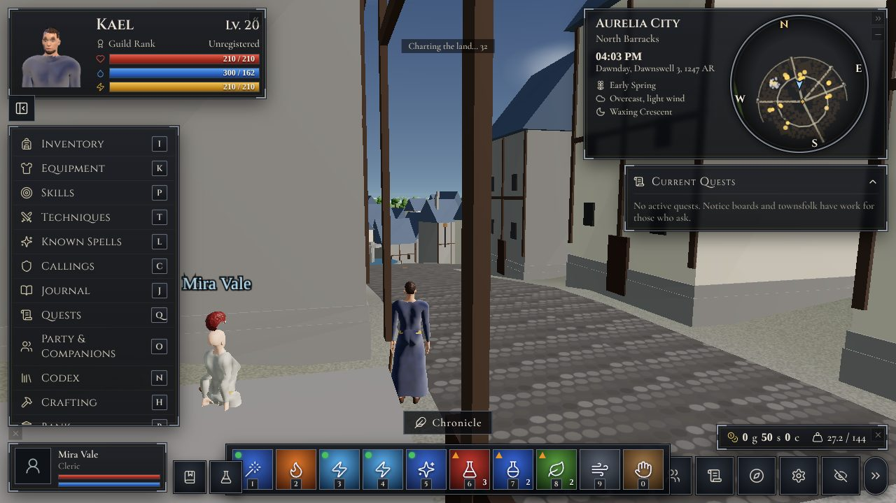
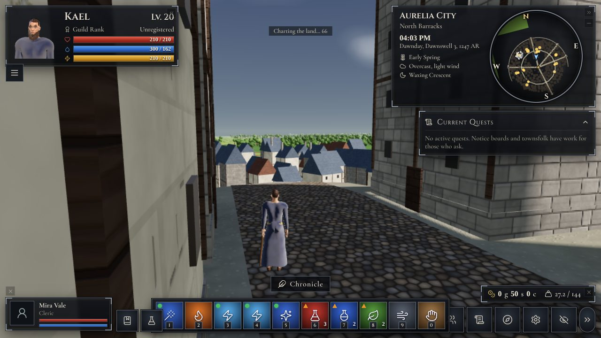
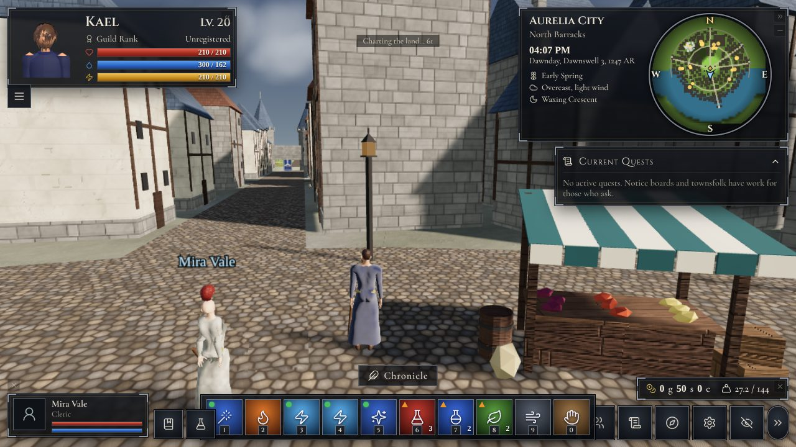
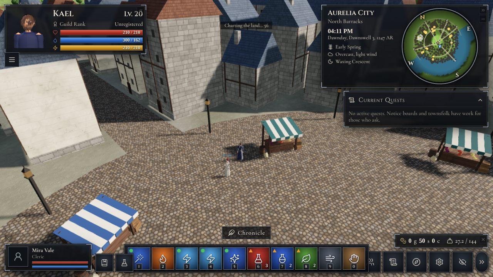
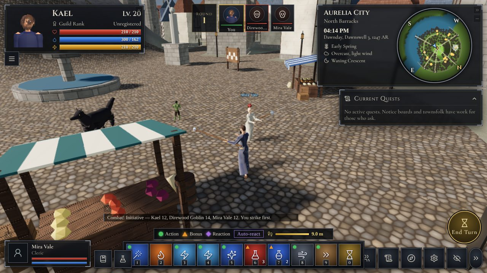
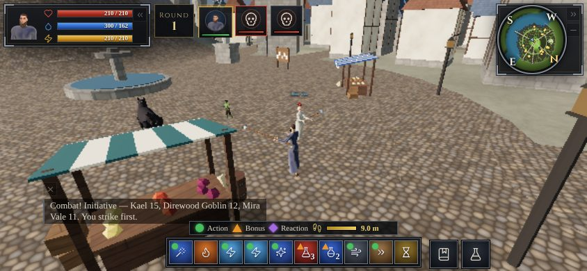
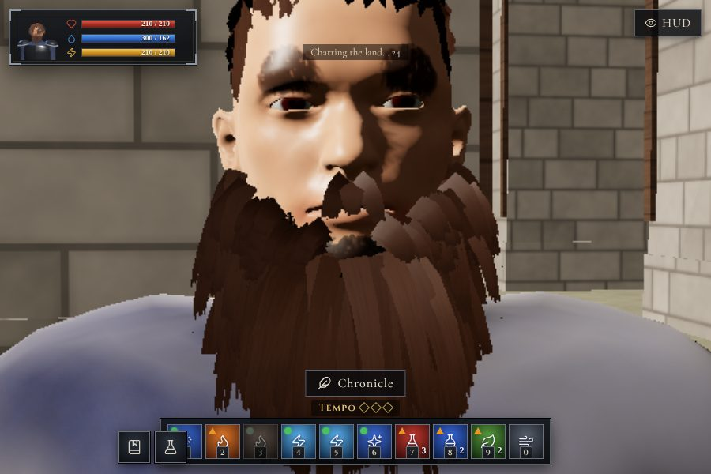 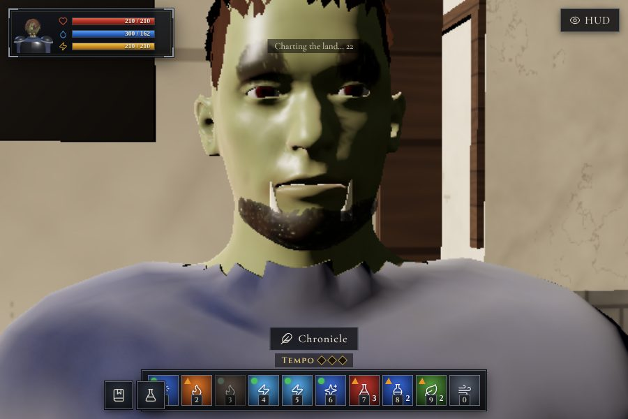

## Status

| Area | State |
|---|---|
| Spells, items, techniques, enemy AI, party, persistence | Done, covered by `browser-test.mjs` scenarios and `unit.mjs` (122 checks) |
| Mobile portrait/landscape combat | Done, tested with simulated touch in headless Chromium |
| Walkable-surface geometry, bridges, ferries, roads, gates | Done; `world-test.mjs` + `world` scenario |
| Camera-relative movement (stick and WASD) | Fixed and tested at 0/90/180/270 degrees |
| Landscape phone layout, safe areas, multi-touch | Done in emulation; not verified on a physical iPhone |
| GLB pipeline (blend, layering, events, faces, sockets, tint, fallback) | Done, tested with the exported template and the built-in human |
| Counterspell / countermelody / dispel-weave | Not implemented in combat (no combat use) |
| Artist-made GLB characters, tuned creature GLB animations | Humans: built-in CC0-based model (see above). Creatures: procedural only |
| Concentration, command-undead, summon duration | Simplified |
| Settings card to edit `world3d-models` | Not built (edit the variable directly) |

Tests: `node tools/unit.mjs`, `node tools/lint.mjs <harness>`, `PW_CORE=<playwright-core/index.mjs> node tools/browser-test.mjs <harness> [scenario...]`.

## How 3D play and the GM share state

The client writes movement, clock, discovery, combat, harvest and consumable results into the normal
variables. The next message you send starts with a short block listing what happened in real time.
The *3D Client Contract* entry tells the GM those results are already applied. When the GM moves you
or advances time in a narrated turn, the client adopts those coordinates and that clock.

## Requirements and limits

- three.js r149 is loaded at runtime from jsDelivr (with an unpkg fallback), because the Yumina
  sandbox strips npm imports but allows `https:` scripts. Players need internet access to those CDNs.
- Characters use the built-in realistic humanoid; creatures, trees and buildings are procedural geometry with generated surfaces.
- Interiors and dungeons are entered through doors and narrated by the GM rather than modelled.
- Swimming and sailing are not modelled; Velkar's islands are reached by road travel on the map or
  by the GM's ferries.

## Building

```bash
python3 -I worlds/eldoria-3d/tools/gen_data.py     # src/data.tsx from the lorebook
python3 -I worlds/eldoria-3d/tools/gen_panels.py   # src/panels.tsx from the original interface
python3 -I worlds/eldoria-3d/tools/gen_index.py    # refresh the verbatim engine block
node worlds/eldoria-3d/tools/check.mjs             # fast syntax check of every module
node worlds/eldoria-3d/tools/build.mjs             # dist/eldoria-3d.json
```

`build.mjs` compiles with Yumina's own multi-file bundler (`packages/app/src/lib/tsx/tsx-bundler.ts`),
stamps the precompiled blob with the repository's `hashRootFiles`, and validates the world against
`worldDefinitionSchema`. It fails on any schema issue the build introduces; the original export's own
legacy values (32 issues, e.g. `"AND"` keyword logic) are carried through unchanged.

### Browser test harness

`tools/harness-entry.tsx` mounts the compiled world through the repository's real `buildComponent`
with a mock `useYumina()`. Build it with
`node worlds/eldoria-3d/tools/build-harness-page.mjs <outDir> <path/to/three.min.js>` and serve
`<outDir>`.

## Layout

```
source/   original world export and its original interface (inputs, unchanged)
lore/     the GM contract entry and the two new variables
src/      the rootComponent files
tools/    generators, build, checks, harness
dist/     eldoria-3d.json (import this; committed). bundle.js is a local build by-product
```

## Screenshots (from the headless test harness, software rendering)


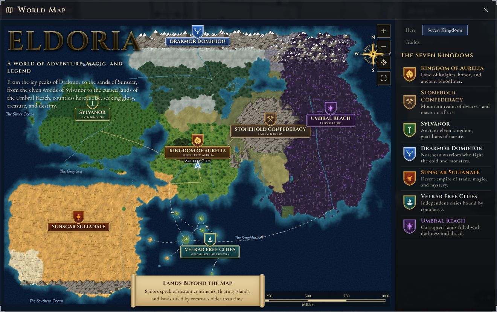
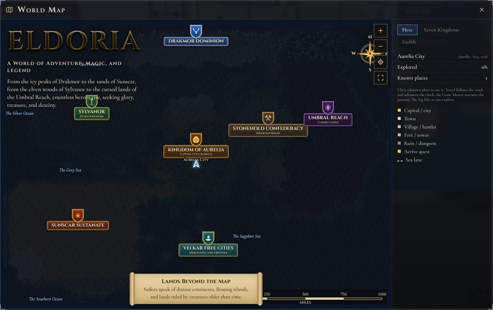


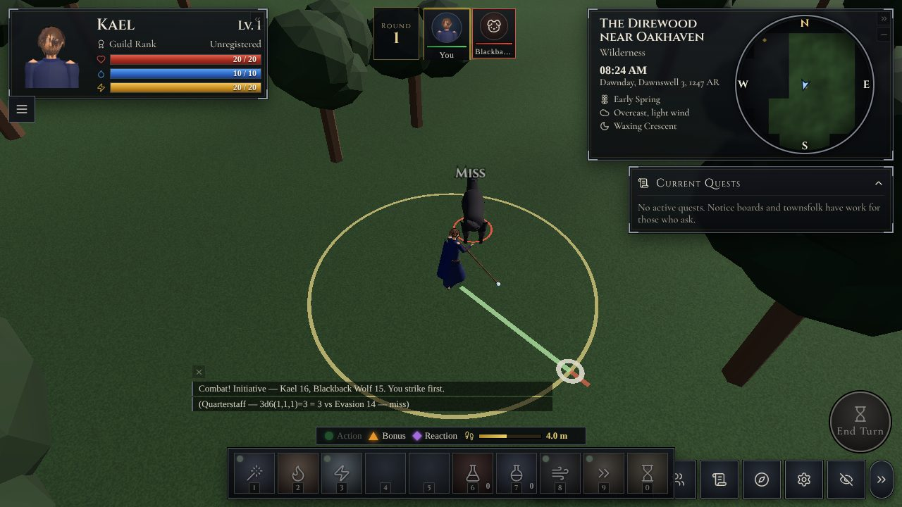
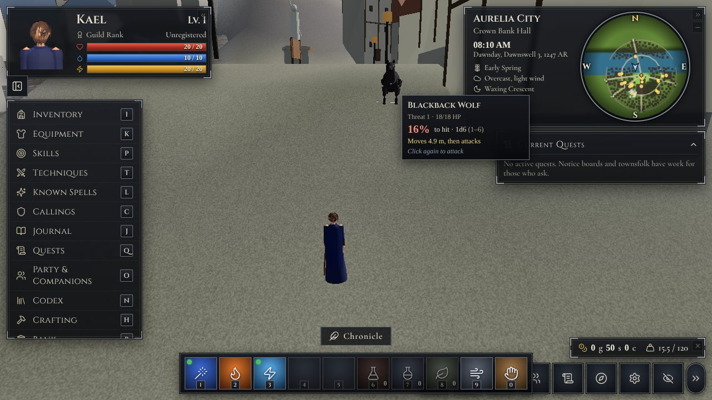
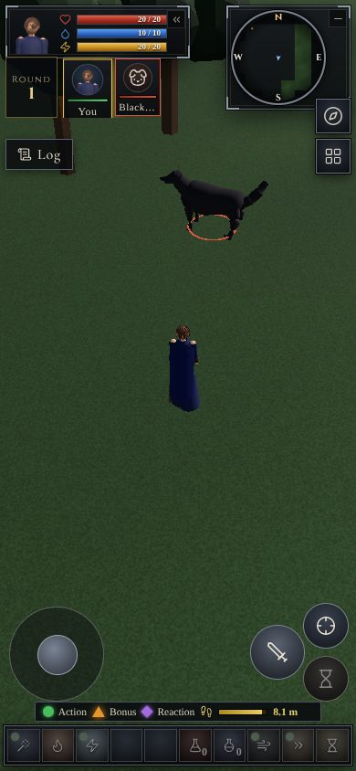
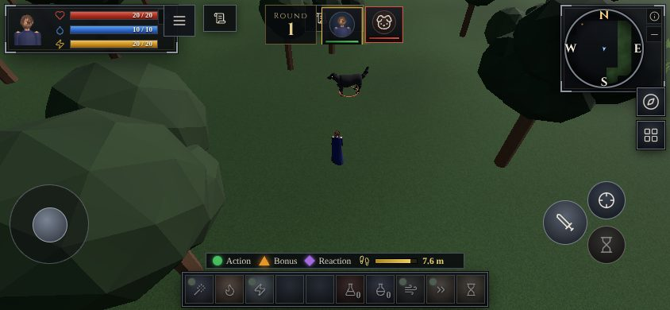
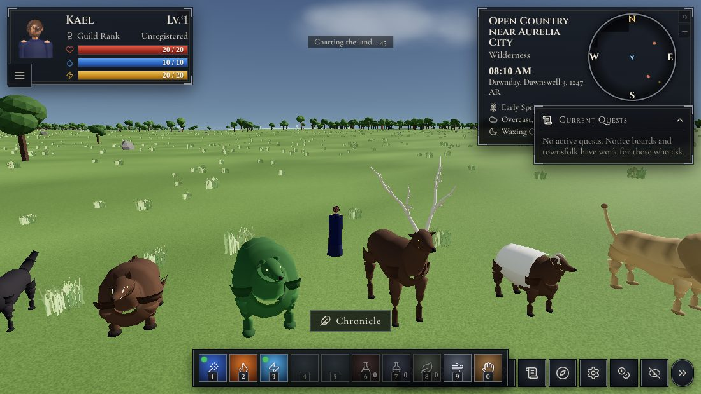
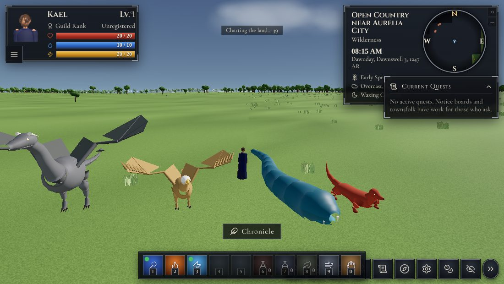
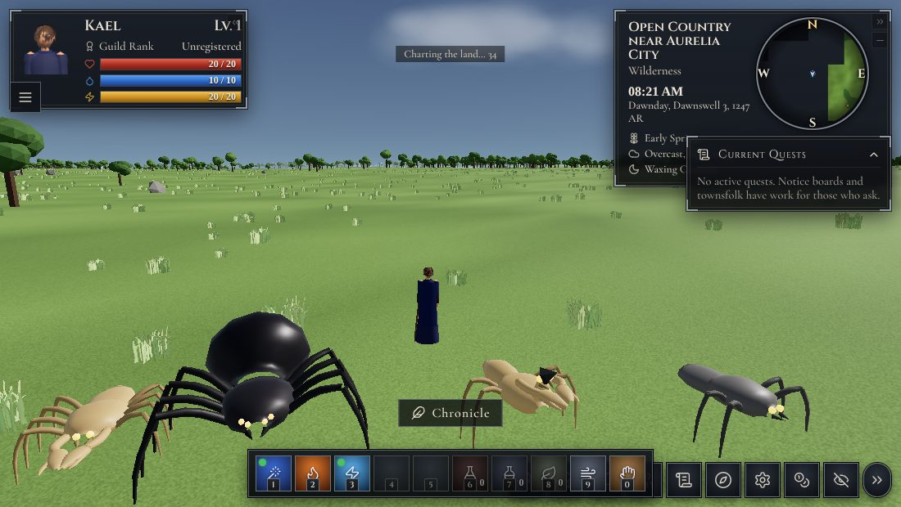
