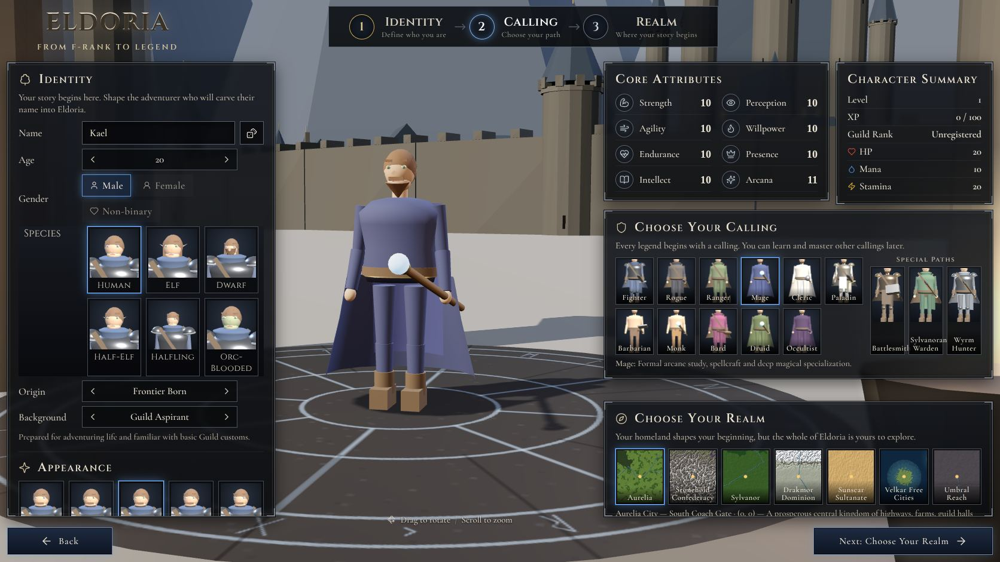
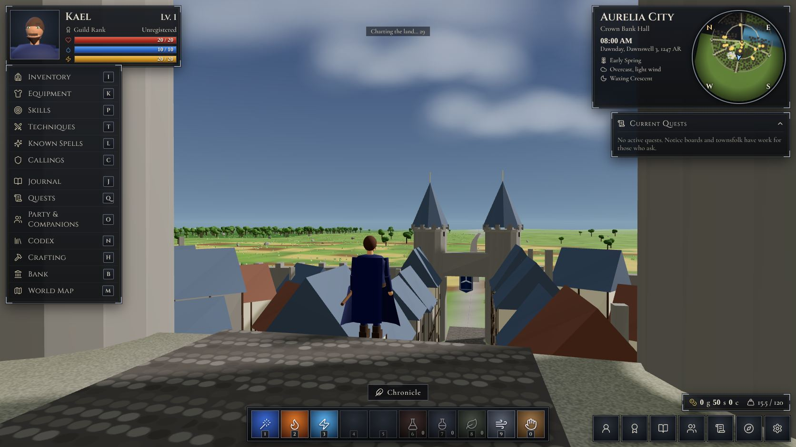
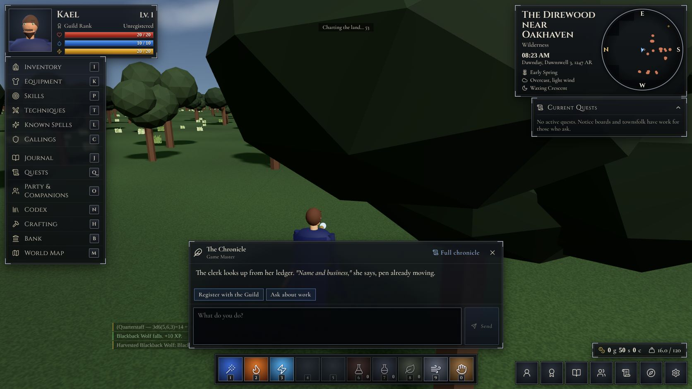
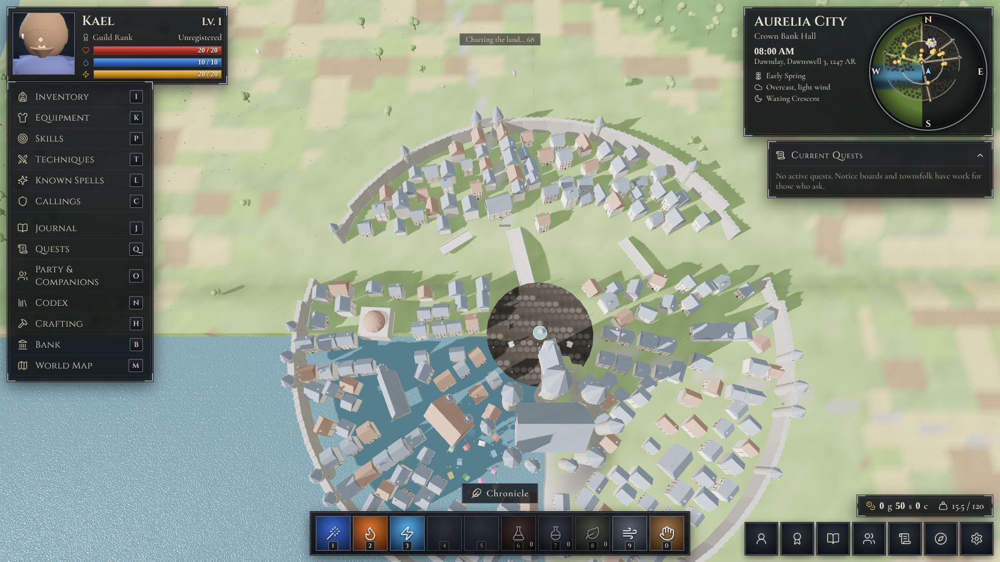
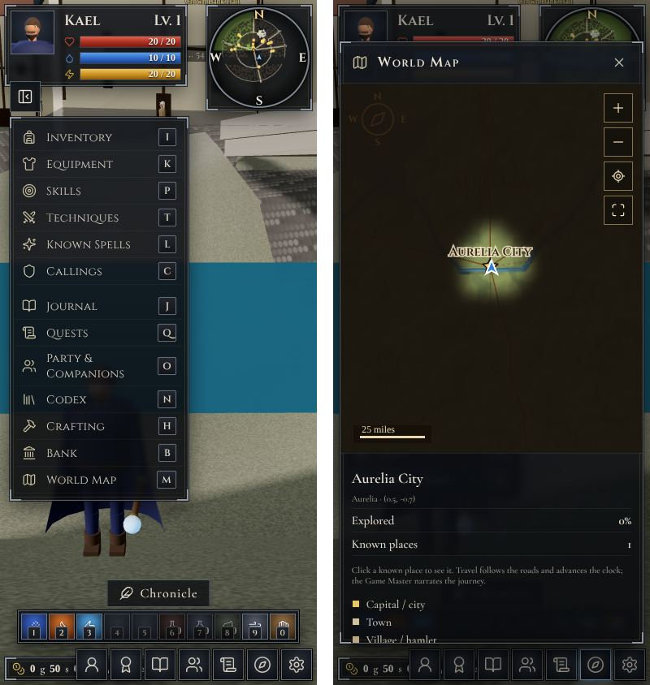

# Eldoria: From F-Rank to Legend — 3D edition

A Yumina world that turns the Eldoria text RPG into a real-time 3D RPG. You walk
the whole continent, fight its monster populations, harvest what you kill, and
uncover a fog-of-war map. The AI Game Master still narrates everything social:
dialogue, trade, quests, training, healing, interiors, and travel events.

**Import this file:** `dist/eldoria-3d.json` (Yumina → Library → Import).

It is the original world, with every lore entry, rule, variable, audio track and
conditional BGM kept as-is, plus:

| Added | What it does |
|---|---|
| New `rootComponent` (12 files in `src/`) | The 3D game and its interface |
| Lore entry **3D Client Contract** (always sent) | Tells the GM what the 3D client already wrote to state, so nothing is applied twice |
| Variable `player-avatar` (`aiAccess: none`) | Appearance chosen in the creator |
| Variable `world3d-state` (`aiAccess: none`) | Fog of war (run-length encoded, 5-mile cells) and slain-population memory |

## What is in the game

- **Character creator** (Identity · Calling · Realm), laid out like the reference art. It has a live 3D
  preview on a rune dais in front of the chosen realm's real capital. Calling cards are rendered from
  the model in each calling's gear. It writes exactly the state the original creator wrote.
- **The continent** is generated from the lorebook: the Atlas Index coordinates (Aurelia City = 0,0;
  1 unit = 1 mile), the mountain ranges, rivers, seas and roads from *Physical Geography* and
  *Roads & Trade Routes*. Rivers run downhill to the sea. Every one of the 85 canonical places exists
  at its coordinates.
- **Settlements** are built from their atlas kind and realm (Aurelian half-timber and slate spires,
  Stonehold holds, Sylvanoran tree-halls, Drakmor longhouses, Sunscar domes, Velkar ports,
  Umbral spires). Each district in the *Fixed Interior Locations* gazetteer becomes a real building
  with a door. Aurelia City has its four gates, the Aurel and its bridges, Crownward Palace, and the
  Golden Lion Guildhall.
- **People.** Canon NPCs stand in their districts: Maren Holt, Doran Vale, Sylas Reigh, Cassian
  Verrow, Bryse Odal, High Sister Elowen, Fingers Nel, and every trainer in the Trainer Index. People
  the GM records in `npc-state` also appear. Talk / Trade / Accept Quest / Train / Inspect go to the GM.
- **Monsters** are persistent populations drawn from the regional Bestiary, with their fixed stat
  blocks. Danger rises with distance from settlements, apex threats live only near apex sites, and
  slain populations stay gone for days.
- **Real-time combat** uses the world's own resolution: 3d6 + attribute mod + bounded skill bonus vs
  Evasion; weapon dice + STR contribution − DR; criticals on a natural 18 with margin 5+; bestiary
  weaknesses; calling resources (Tempo, Fury, Focus, Resonance, Devotion, Momentum). Known spells
  cast from the hotbar. Kills award XP and skill progress; corpses can be harvested for the loot
  their anatomy provides.
- **Maps.** A rotating circular minimap (N/E/S/W ring) plus a world map at true equal scale. Fog
  lifts as you explore. Known locations (including ones the GM teaches you) are pinned, and you can
  travel by road to discovered places.
- **HUD** like the reference: portrait and bars, the I/K/P/T/L/C/J/Q/O/N/H/B/M menu, party frames,
  location, time, season, weather and moon, the quest tracker, a 10-slot hotbar, wallet and weight.
  The original sheet panels (attribute spending, equipment, skills, callings, banking, crafting,
  markets, quest boards, party, codex) are reused verbatim from the original interface.
- The original interface's **engine logic** is kept verbatim in `src/index.tsx`: XP → level,
  advancement points, HP/Mana/Stamina maxima, skill rollover, calendar and moon correction,
  encumbrance, and adaptive ambience.

## How 3D play and the GM share state

The client writes movement, clock, discovery, combat, harvest and consumable results into the normal
variables. The next message you send starts with a short block listing what happened in real time.
The *3D Client Contract* entry tells the GM those results are already applied. When the GM moves you
or advances time in a narrated turn, the client adopts those coordinates and that clock.

## Requirements and limits

- three.js r149 is loaded at runtime from jsDelivr (with an unpkg fallback), because the Yumina
  sandbox strips npm imports but allows `https:` scripts. Players need internet access to those CDNs.
- The art is procedural low-poly 3D, not the painted look of the concept images.
- Interiors and dungeons are entered through doors and narrated by the GM rather than modelled.
- Swimming and sailing are not modelled; Velkar's islands are reached by road travel on the map or
  by the GM's ferries.

## Building

```bash
python3 -I worlds/eldoria-3d/tools/gen_data.py     # src/data.tsx from the lorebook
python3 -I worlds/eldoria-3d/tools/gen_panels.py   # src/panels.tsx from the original interface
python3 -I worlds/eldoria-3d/tools/gen_index.py    # refresh the verbatim engine block
node worlds/eldoria-3d/tools/check.mjs             # fast syntax check of every module
node worlds/eldoria-3d/tools/build.mjs             # dist/eldoria-3d.json
```

`build.mjs` compiles with Yumina's own multi-file bundler (`packages/app/src/lib/tsx/tsx-bundler.ts`),
stamps the precompiled blob with the repository's `hashRootFiles`, and validates the world against
`worldDefinitionSchema`. It fails on any schema issue the build introduces; the original export's own
legacy values (32 issues, e.g. `"AND"` keyword logic) are carried through unchanged.

### Browser test harness

`tools/harness-entry.tsx` mounts the compiled world through the repository's real `buildComponent`
with a mock `useYumina()`. Build it with
`node worlds/eldoria-3d/tools/build-harness-page.mjs <outDir> <path/to/three.min.js>` and serve
`<outDir>`.

## Layout

```
source/   original world export and its original interface (inputs, unchanged)
lore/     the GM contract entry and the two new variables
src/      the rootComponent files
tools/    generators, build, checks, harness
dist/     eldoria-3d.json (import this; committed). bundle.js is a local build by-product
```

## Screenshots (from the headless test harness, software rendering)






